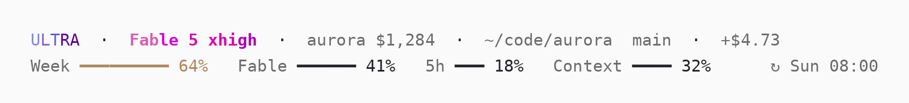
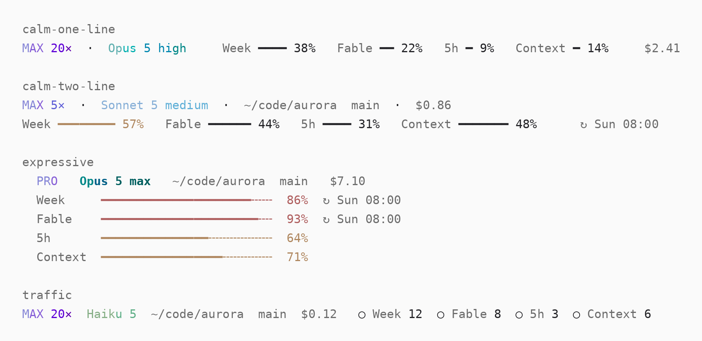

# claude-statusline

<picture>
  <source media="(prefers-color-scheme: dark)" srcset="docs/images/hero-dark.png">
  
</picture>

A calm status line for Claude Code. It keeps your weekly limit, the model-specific weekly limit, the five-hour window and the context of the running session in view, and, if you like, what your work has cost per project.

`/usage` shows the same limits, but only when you ask. This keeps them on screen, so you notice the limit before you run into it.

## Install

As a plugin, inside Claude Code:

```
/plugin marketplace add milhero/claude-statusline
/plugin install calm-statusline@milhero
/calm-statusline:setup
```

Or from a clone:

```bash
git clone https://github.com/milhero/claude-statusline.git
cd claude-statusline
python3 install.py            # on Windows: py install.py; --dry-run and --help work too
```

Both ways write one key, `statusLine`, into your Claude Code `settings.json` (a backup of the file is kept, its permissions stay) and add a `claude-costs` command to `~/.local/bin` (skip it with `--no-command`). An existing status line is only replaced with `--force`, and comes back when you uninstall.

To remove it, run `python3 install.py --uninstall`, or as a plugin user ask `/calm-statusline:setup` to remove it before `/plugin uninstall calm-statusline@milhero`. Your data (archive, invoices, rules) stays in `~/.claude/claude-statusline/` until you delete that folder.

Needs Python 3.9 or newer, no packages. Works on Linux, macOS and Windows, with Claude Code 2.1.251 or newer.

## How it looks

The reading order is fixed: who you are, what you use, what it costs. The plan comes first as a signature and never drops out. The line follows the window width: when it gets narrow, side details go first, then labels get shorter, then the gauges. When it gets wide, the reset time appears instead of empty space.

<picture>
  <source media="(prefers-color-scheme: dark)" srcset="docs/images/layouts-dark.png">
  
</picture>

Colour is used sparingly. Readings that need no attention keep your terminal's text colour; muted ochre appears from 50 percent, muted terracotta from 80. Labels stay in the background so the numbers carry the line.

The plan gets a gradient within a single hue. Only lightness and saturation change, never the hue, so it reads as a sheen rather than as colourful. A higher plan uses more of the family: the effect comes from the span, not from brightness.

<picture>
  <source media="(prefers-color-scheme: dark)" srcset="docs/images/tiers-dark.png">
  
</picture>

Model and effort share one colour: Haiku green, Sonnet blue, Opus teal, Fable magenta, and the effort level decides how much of that family the text runs through. From `xhigh` on, bold joins in, because colour alone no longer separates the top levels. On a light terminal theme every tone moves to a darker one of the same hue.

`python3 statusline.py --demo` shows every layout with sample values, `--colors` every colour family.

## Settings

`~/.claude/claude-statusline/config.json` (inside `CLAUDE_CONFIG_DIR` if you set it). Missing keys use these defaults:

| Key | Default | Meaning |
| --- | --- | --- |
| `theme` | `calm-one-line` | `calm-one-line`, `calm-two-line`, `expressive` or `traffic` |
| `language` | `auto` | `en` or `de`; `auto` follows your system |
| `gauge_style` | `line` | `line`, `circle`, `block` or `spark` |
| `gauge_track` | `false` | Hint at the unused part of a gauge |
| `plan_style` | `violet` | `violet`, `terracotta`, `blue`, `green`, `grey` or `plain` |
| `background` | `auto` | `dark` or `light`; `auto` follows Claude Code's theme |
| `thresholds.warn` / `.critical` | `50` / `80` | Where ochre and terracotta begin |
| `show.week`, `show.model_week`, `show.five_hour`, `show.context` | `true` | The four readings |
| `show.plan`, `show.model`, `show.effort`, `show.directory`, `show.git_branch` | `true` | Identity and place |
| `show.cost` | `false` | List price of the running session |
| `show.project` | `false` | Value of the current project (needs the cost tracker) |
| `cache_seconds` | `300` | How often the account lookup refreshes |
| `live_lookup` | `true` | Turn off to make no network request at all |
| `xhigh_as_ultracode` | `false` | Label `xhigh` as `ultracode` (cannot be measured, see below) |
| `project_roots` | `[]` | Folders whose subfolders are projects even without git |
| `git_author_emails` | `[]` | Your commit addresses, if git's `user.email` does not cover them all |
| `color` | `auto` | `always` or `never` |

Every single-value key can be overridden per terminal with an environment variable, for example `CCSL_THEME=traffic` or `CCSL_SHOW_COST=1`.

## Where the numbers come from

Weekly limit, five-hour window, context, model, effort and session cost come from Claude Code itself, through the status line input.

The model-specific weekly limit is not in there. It comes from an undocumented endpoint on `api.anthropic.com`, called with your existing Claude Code login. So does the plan name, because the one stored at login goes stale after a plan change. Both requests run in a detached background process at most every `cache_seconds` (the plan at most hourly); the line never waits for the network. If the server says it gets too many requests, the lookups pause for as long as it asks, and longer each time it repeats. If they fail, exactly these values are missing and everything else stays. With `"live_lookup": false` nothing goes over the network.

Ultracode cannot be detected from outside: it reports itself as `xhigh`. Labelling it anyway would be a claim, not a measurement, which is why it is a setting.

## Cost per project

Optional. Turn it on in the setup, or with `"cost_tracking": true`.

```
2026-03-02  to  2026-05-29   (54 active days)

Project           API value    Share  Subscription     Compute
──────────────────────────────────────────────────────────────
aurora            $3,418.20    61.7%       €142.60      64.3 h
~ field-notes     $1,204.90    21.8%        €51.10           –
website             $917.40    16.5%        €38.30      17.9 h
──────────────────────────────────────────────────────────────
Total             $5,540.50   100.0%       €232.00      82.2 h

Subscription in this period €270.00, of which €38.00 unused (days without work).
```

**API value** is what the same work would have cost at API list prices, in dollars. **Subscription** is the part of the fee you actually paid that falls on the project, in the currency of your invoices. **Compute** is the time the model actually worked. Rows marked `~` are mostly estimated.

How it measures:

- Claude Code deletes its logs after 30 days by default. The tracker condenses them into an archive (one line per session) every few hours in the background, so nothing is lost and no system timer is needed.
- Costs come from Claude Code's own cost lines, counted once per process. Sessions that were aborted before writing one are computed from their tokens.
- A session belongs to the git repository it worked in: the working directory, edited files and paths in shell commands all count, weighted by output. Worktrees count towards their main repository. Rules can split a monorepo or merge repositories.
- The subscription fee is spread day by day from your real invoices. Days without work stay visible as unused.
- The time before the archive can be estimated from your own commits in the git history. The estimate is frozen once, so later measurements do not rewrite the past.
- A self-check verifies that the numbers add up and warns if Claude Code's log format changes.

The easiest way to set it up is `/calm-statusline:cost-setup`: Claude takes stock (projects, logs, invoices, history), proposes rules where detection is not enough, helps you enter your invoices, and then questions the result with you. It only writes the settings files; all numbers come from the code.

From the terminal, `claude-costs` (or `/calm-statusline:costs` inside Claude Code):

| Command | Shows |
| --- | --- |
| `claude-costs` | The table per project |
| `claude-costs --period 2026-09` | One month, also `2026` or `2026-09-05` |
| `claude-costs --project aurora` | One project |
| `claude-costs --by-source` | Measured against estimated |
| `claude-costs --formula` | How it is computed, with the rates used |
| `claude-costs --compare` | How long the same work would take on other plans |
| `claude-costs --check` | The self-check |
| `claude-costs --history` | Totals day by day |
| `claude-costs --discover` | Fact-finding as JSON, used by the setup |

Files, all in `~/.claude/claude-statusline/`: `cost-rules.json` (rules), `invoices.json` (invoices), `other-machines.json` (work done on other machines), `cost-summary.json` (the result, for anything else that wants to read it).

## Troubleshooting

`python3 statusline.py --diagnose` goes through every source and says which one answers. The token is never printed.

On macOS Claude Code keeps its login in the keychain; the first lookup may ask whether Python may read it. Without access only the model week and the server plan are missing.

With a custom status line, Claude Code hides part of its own keyboard hints, such as `esc to interrupt`. The shortcuts keep working.

## Development

```bash
python3 -m unittest discover -s tests -t .
```

No packages, no network. CI runs on Linux, macOS and Windows with Python 3.9 and 3.12. The images in this README are rendered from the code with `tools/render_images.py`.

## License

GPL-3.0. See [LICENSE](LICENSE).
